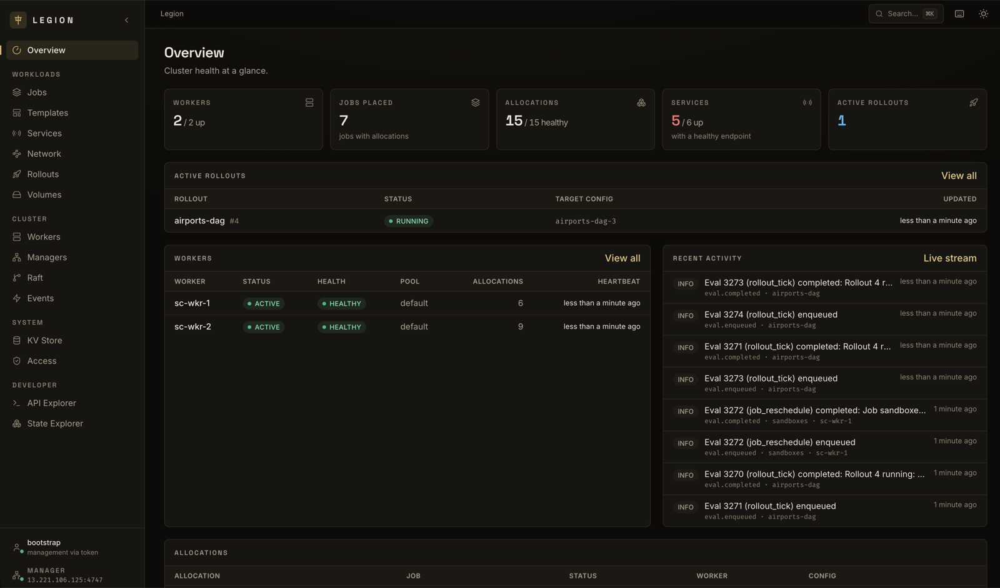
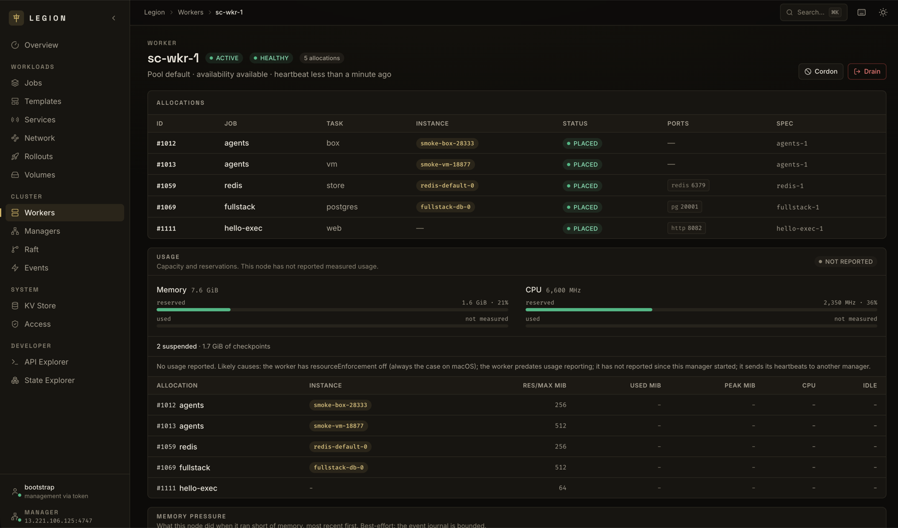
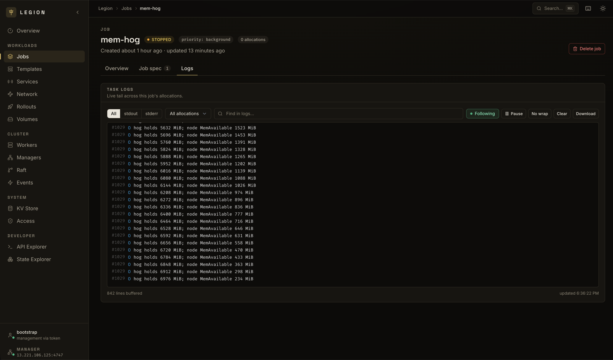
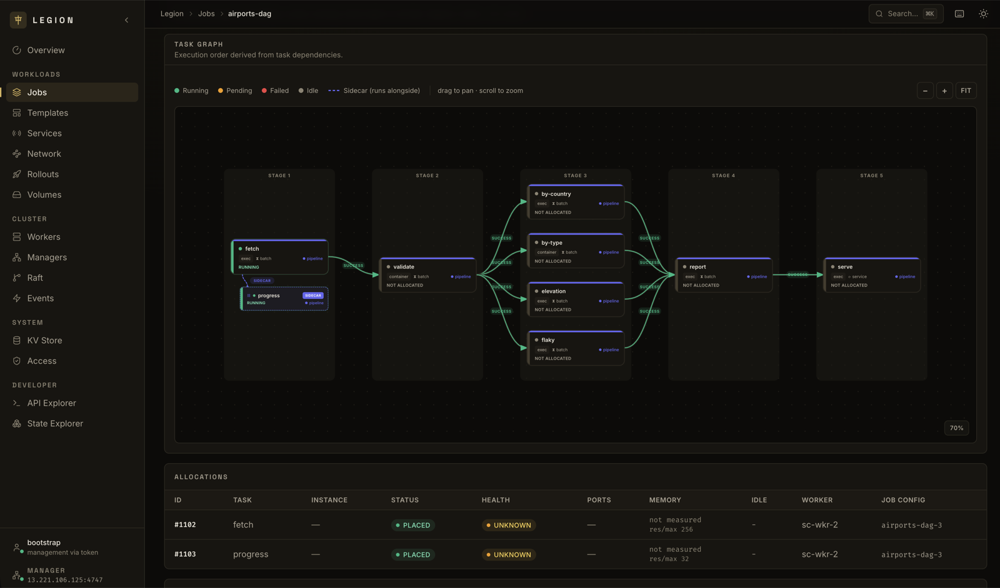

# Legion

**A workload orchestrator that is easy, fast, and extensible.**

> [!NOTE]
> Legion is an experimental personal project written largely by agents. Expect bugs, breaking changes,
> and known security issues. See [Status](#status) before you use it.

Legion runs containers, microVM sandboxes, and plain binaries across a fleet
of machines. You describe a job, and Legion decides where it runs, starts it,
keeps it healthy, rolls out new versions, and routes traffic to it. It does
the same job as [Kubernetes](https://kubernetes.io) or
[Nomad](https://www.nomadproject.io), with far fewer moving parts.

Legion ships as **one ~26 MB binary** that is the manager, the worker, the
CLI, and an MCP server. State is stored in SQLite and optionally streamed
to object storage or persisted using Raft.

```
                ┌──────────────────────┐
   legion CLI ─►│       Manager        │  scheduler, ACLs, KV, service catalog
   UI / MCP   ─►│   gRPC on :4747      │  state in SQLite (local, streamed, or Raft)
                └──────────┬───────────┘
            ┌──────────────┼──────────────┐
       ┌────▼───┐     ┌────▼───┐     ┌────▼───┐
       │ Worker │     │ Worker │     │ Worker │   exec · container · sandbox (microVM)
       └────────┘     └────────┘     └────────┘   macOS · Linux
```

## Why Legion?

Legion aims to be the orchestrator you can start in a minute and
still be happy with at fifty thousand nodes.

### Easy to use

- **One binary, one command per node.** `legion start manager` and
  `legion join <token>` are the whole install.
- **Batteries included.** [Service discovery](docs/service-discovery.md), a
  [service mesh with mTLS](docs/network-handlers.md), a
  [versioned KV store](docs/kv-store.md) with
  [encryption at rest](docs/kv-encryption.md),
  [rollouts](docs/rollouts.md), [ACLs](docs/auth-and-acls.md) with
  [namespaces](docs/namespaces.md),
  [workload identity (OIDC)](docs/workload-identity.md), and a [web UI](#web-ui).
- **Readable job specs.** [Nickel](docs/configuration-language.md) gives you
  types, imports, and functions for DRY specs. You don't need YAML or Helm
  charts.
- **Raft is optional.** State always lives in SQLite. A single manager keeps
  it on local disk, where you can query it directly. For durability,
  [stream it to object storage](docs/persistence-streaming.md) or replicate
  it with [Raft](docs/multi-raft.md), whichever suits you.
- **Easy local dev.** Works out of the box on Linux, and on macOS with
  Apple's [`container`](https://github.com/apple/container).

### Fast

Legion is fast whether it's placing services across a large fleet or booting
sandboxes on demand.

In [benchmarks](docs/benchmarks.md), Legion placed work **~13x faster than
Kubernetes at 1,000 nodes** and **~50x faster at 10,000 nodes**. How it gets
there:

- **In-memory state instead of etcd.** The scheduler plans against
  in-memory state and persists to SQLite, so a decision never waits on an
  external store.
- **A scheduler built for large fleets.**
  [Scheduling indexes](docs/scheduling-indexes.md) keep candidate selection
  cheap as the fleet grows, and the scheduler picks the right index for each
  task on its own. [Late-binding plan apply](docs/late-binding-plan-apply.md)
  stops concurrent submits from fighting over the same node.
- **Heartbeats that adapt to the fleet.** With
  [adaptive cadence](docs/heartbeat-cadence-and-scale.md), on by default,
  the manager stretches each worker's check-in interval as the fleet grows,
  so a busy control plane doesn't mistake healthy nodes for dead ones. A
  circuit breaker refuses to mark half the fleet lost in one tick.

Legion can boot a sandbox in 0.2 seconds and sustain ~150 boots per second
on a large node. Nodes start sandboxes without a manager in the path, so the
boot rate grows with the fleet. By our projections, a thousand-node cluster
could start a million sandboxes in tens of seconds. How it gets there:

- **Fast microVM boots.** A sandbox goes from create to running code in
  about 180 ms, and a 96-vCPU node sustains 150 to 200 boots a second.
  Each node caches images and a base root disk per image, so a new
  sandbox's disk is a [reflink clone](docs/task-runtime-sandbox.md#the-root-disk-cache)
  made in milliseconds. Most of the boot is the guest kernel itself.
- **Start work on the edge.** With [edge boot](docs/edge-boot.md), a worker
  boots a sandbox before its placement is durable, so work starts right away
  and is still committed for self-healing later. For disposable sandboxes,
  [session mode](docs/session-mode.md) skips the replicated log entirely.
  Nodes reserve room up front and report what they run, so a start or stop
  costs zero replicated writes.

See [Sandboxes at Scale](docs/sandboxes-at-scale.md) for the numbers and
[Built to run agents](#built-to-run-agents) for what else Legion does for
sandboxes.

### Flexible

- **Plugins everywhere.** Task runtimes, scheduling logic, rollout strategies,
  artifact fetchers, volumes, node health checks, and key management are all
  [plugins](docs/plugin-system.md). Scheduling plugins read the same
  in-memory state as the built-in policies, so custom placement logic costs
  no extra round trips.
- **Any isolation level.** Run plain processes with
  [`exec`](docs/task-runtime-exec.md), OCI images with
  [`container`](docs/task-runtime-container.md), or untrusted code in
  microVMs with [`sandbox`](docs/task-runtime-sandbox.md). Need something
  else? A [custom runtime](docs/task-runtime-plugins.md) is a Rust
  crate that implements one trait, and the
  [`noop` example](plugins/tasks/noop/src/lib.rs) is under 100 lines.
- **Any kind of workload.** Long-running services, batch jobs, sidecars, and
  [stateful workloads](docs/stateful-workloads.md) with stable identity and
  [volumes](docs/volumes.md). Distributed jobs set
  [`gang`](docs/gang-scheduling.md) so their replicas place all at once or
  wait, holding nothing, until they can, and restart together when one is
  lost.
- **A built-in DAG system.** Tasks declare `dependsOn` to form a
  [dependency graph](docs/jobs-tasks-and-scheduling.md), gated on another
  task starting, completing, or succeeding. Dependencies can span groups
  placed on different nodes, so you don't need a separate workflow engine.
- **Small enough for the edge.** The shipping binary is ~26 MB, against
  ~82 MB for k3s and ~150 MB for Nomad. It runs on macOS and Linux.

### Built to run agents

In addition to [booting fast and scaling well](#fast), Legion has other
features that make sandboxes work great:

- **MicroVMs built in.** The [`sandbox`](docs/task-runtime-sandbox.md)
  runtime boots workloads in Firecracker or Cloud Hypervisor on Linux, and
  in Apple's `container` on macOS.
- **Simple egress control.** Easily define
  [networking rules](docs/network-handlers.md), egress proxies, and
  [credential injection](docs/network-handlers.md#credential-injection) from
  outside the sandbox.
- **A shell in any sandbox.** [`legion exec`](docs/exec-and-actions.md)
  reaches into Linux microVM sandboxes through the guest agent.
- **Suspend when idle, resume on demand.** A sandbox
  [suspends](docs/suspend-and-resume.md) to a memory checkpoint once it goes
  quiet, judged by network traffic, open connections, CPU use, or exec
  sessions. It gives its reservation back, so new work packs into the room
  it left. When a node runs short on memory, it suspends the most idle
  sandboxes first and evicts other work only if that isn't enough. A
  suspended sandbox resumes in place with its processes intact when you
  start it or when the next request reaches the [gateway](docs/gateway.md).
  Snapshots let you roll one back, and fork copies a running one for an
  agent to explore from. See the
  [agent sandboxes guide](docs/guides/agent-sandboxes.md).

### DevEx for humans and agents

- **MCP server built in.** `legion mcp serve` exposes the cluster to any MCP
  client, read-only unless you pass `--allow-write`.
- **Structured output everywhere.** Every CLI command emits a typed JSON
  envelope with `--json`, with error codes, hints, and a retryable flag.
- **A self-documenting CLI.** `legion capabilities` lists every operation,
  and `legion job schema` emits the job spec as JSON Schema.
- **Safe to retry.** Mutating RPCs accept idempotency keys, and
  `legion job plan` previews a change before anything runs.
- **Traces, metrics, and events.** Managers and workers export
  [traces over OTLP](docs/observability.md) to any OpenTelemetry backend,
  covering RPCs, evals, scheduling, and plan apply.
  [Prometheus metrics](docs/metrics.md) and the
  [event stream](docs/event-stream.md) cover the rest, so you can see every
  state change as it happens.

See [Agent Readiness](docs/agent-readiness.md) for the full picture.

## Web UI

Legion comes with a web UI for the whole cluster. Run it from
[`ui/`](ui/README.md), and see [UI Architecture](docs/ui-architecture.md)
for how it's built.

<table>
  <tr>
    <td width="50%" valign="top">
      <b>Overview</b><br>
      
    </td>
    <td width="50%" valign="top">
      <b>Worker</b><br>
      
    </td>
  </tr>
  <tr>
    <td width="50%" valign="top">
      <b>Job</b><br>
      
    </td>
    <td width="50%" valign="top">
      <b>Task graph</b><br>
      
    </td>
  </tr>
</table>

More pages: [sandbox instance](docs/images/ui/sandbox-instance.png) ·
[network](docs/images/ui/network.png) · [service](docs/images/ui/service.png) ·
[KV store](docs/images/ui/kv-store.png)

## Quickstart

Install from [crates.io](https://crates.io/crates/legion-rs). You need
[Rust](https://rustup.rs) and `protoc` (`brew install protobuf` or
`apt-get install protobuf-compiler`).

```bash
cargo install legion-rs
```

Start a manager with a worker running in the same process. The defaults work
without a config file, from any directory.

```bash
legion start manager --run-worker

# Or, for a throwaway local cluster, turn ACLs off. Any caller, including
# any task, can then control the cluster.
legion start manager --run-worker --no-acl
```

If you keep ACLs on, see [Auth & ACLs](docs/auth-and-acls.md) for tokens
and access from other machines.

In another terminal, write a job. Job specs use [Nickel](https://nickel-lang.org),
a small typed configuration language, but plain JSON works too.

```nickel
# hello.ncl
{
  name = "hello",
  tasks = [
    {
      name = "web",
      runtime = "exec",
      lifecycle = "service",
      count = 2,
      config = {
        command = ["sh", "-c", "exec python3 -m http.server $LEGION_PORT_HTTP"],
      },
      network = { ports = [{ name = "http" }] },   # Legion picks a free port
      service = { port = "http" },                 # and registers it for discovery
      checks = [{ type = "health", kind = "tcp", port = "http", every = "5s", timeout = "2s" }],
      resources = { memory = 128 },
    },
  ],
}
```

Preview it, run it, and watch it come up:

```bash
legion job plan hello.ncl       # what would change, without changing anything
legion job run hello.ncl
legion job info hello           # status: pending, then running
legion job logs hello
```

Find the running service and hit it:

```bash
legion service resolve web
curl "http://$(legion service resolve web --one)"
```

Change the spec and run it again to roll out a new version, or scale it with
`legion job scale hello --count 5`.

### Add more machines

Adding a worker is two commands. Mint a join token on the manager, then paste
it on the new machine.

```bash
# on the manager, mint a join token
legion join-token create --ttl 24h

# on the new machine, use the returned token
legion join lgnjoin_...
```

The token sets up a secure connection between the worker and your manager.
See [Managers and Workers](docs/architecture-managers-workers.md#ports-and-who-dials-whom)
for ports and network setup.

### Example job specs

A few from [`configs/jobs/`](configs/jobs/):

- [`min.ncl`](configs/jobs/min.ncl): a small valid job with one container.
- [`sandbox-egress-demo.ncl`](configs/jobs/sandbox-egress-demo.ncl): an agent
  task that can reach only allowlisted upstreams.
- [`sandbox-edge-boot.ncl`](configs/jobs/sandbox-edge-boot.ncl): per-user
  microVM sandboxes that boot before their placement is durable.
- [`container-service.ncl`](configs/jobs/container-service.ncl): nginx in a
  container on a dynamic port, with an HTTP health check.
- [`batch-job.ncl`](configs/jobs/batch-job.ncl): a run-to-completion host
  process on the `exec` runtime (no image), with a retry policy.
- [`per-node.ncl`](configs/jobs/per-node.ncl): one instance on every node,
  like a DaemonSet or a Nomad system job.
- [`nickel-showcase.ncl`](configs/jobs/nickel-showcase.ncl): functions, an
  import, contracts, and `--var` variables with defaults, all in one spec.
- [`dag-separate-groups.ncl`](configs/jobs/dag-separate-groups.ncl): batch
  prep tasks that fan out and back in before the services in other groups
  start.
- [`kv-reactive-demo.ncl`](configs/jobs/kv-reactive-demo.ncl): a task that
  reads a value from KV, encrypted at rest by default, and restarts when it
  changes.
- [`postgres.ncl`](configs/jobs/postgres.ncl): a stateful database with a
  persistent volume.
- [`fullstack.ncl`](configs/jobs/fullstack.ncl): an nginx frontend, a
  Python API, and Postgres, wired together through the service mesh, with
  each tier scaling on its own.
- [`maximal.ncl`](configs/jobs/maximal.ncl): every field Legion accepts.

## Status

Legion is a personal project, made for fun, and largely an experiment with
agentic development. Most testing has been done by agents, with human
spot checks. Expect bugs, and don't run it in production.

Don't expect stability either. APIs and the job spec may change without
notice.

With recent LLM progress, I've been shipping "foundational" pieces of the
orchestrator quickly (often without reading the code) and then coming
back to iterate on them (or rip them out) after the fact. This is fun and
allows me to get to the end-experience quicker, but means pieces of the
orchestrator are of differing quality.

For instance, the core scheduler has gotten a decent amount of testing and
review, while things like the networking stack and sandbox runtime are newer
and have had less review/testing/thought.

The [docs](docs/README.md) should state what is and is not implemented for
each feature.

Caveat emptor!

### Known security issues

Don't run Legion where untrusted workloads share a host with other work, or
on a network you don't trust. Known gaps:

- **`exec` tasks run on the host, as root unless they set a `user`.**
  They share the host's network. Submitting one needs a `job:write` rule
  with `host = true` ([host-level jobs](docs/auth-and-acls.md#host-level-jobs)),
  because whoever can deploy one is root on every node it lands on. On Linux
  with cgroup v2 and `nft`, the
  [kernel host guard](docs/network-handlers.md#the-host-guard-in-the-kernel)
  keeps them off Legion's ports, the cloud metadata service, and other
  allocations' listeners, but a root task can remove it. Run untrusted code
  in `container` or `sandbox`, never `exec`.
- **Git and OCI artifact fetches are not checked by the host guard.** HTTP
  fetches are, redirects included, but a `git::` or `oci://` source on an
  internal address is fetched by the worker and lands in the task directory
  ([Artifacts](docs/artifacts.md#what-the-host-guard-checks)).
- **Revoking access to a direct exec session takes up to a heartbeat.**
  Deleting the token or delegated key behind a
  [direct exec](docs/exec-and-actions.md#direct-exec) session closes it on
  the worker's next heartbeat, about 2 seconds on fleets up to 2,500 nodes
  and longer beyond that.

### What's next

Open work lives in the [to-do list](internal_docs/TODO.md), with design plans
in [`internal_docs/plans/`](internal_docs/plans/). A few things I'd like to
add:

- **Faster sandbox wake-ups.** Node-local wake on connect and diff snapshots
  on top of [suspend and resume](docs/suspend-and-resume.md).
- **Built-in ingress gateway, autoscaler, cert-manager, and GitOps tools,**
  for a more omakase starting experience.
- **Resource registry.** Share and pull jobs, templates, and plugins.
- **Sharded scheduler.** Scale placement throughput past a single Raft
  cluster.
- **Submission middleware.** Modify or gate job submissions.
- **Something akin to Kubernetes controllers.** Extend Legion with your own
  reconcile loops.
- **More runtimes.** WASM or remote serverless workloads, for example.
- **Namespaces, multi-cluster federation, and Windows support.**

## Documentation

The full index lives at **[docs/README.md](docs/README.md)**. Good places to
start:

- **Installing:** [Legion and its runtimes](docs/installation.md) (runc,
  cloud-hypervisor, a guest kernel, Apple `container`)
- **Concepts:** [Managers and Workers](docs/architecture-managers-workers.md) ·
  [Jobs, Tasks, and Scheduling](docs/jobs-tasks-and-scheduling.md) ·
  [Configuration Language](docs/configuration-language.md) ·
  [Scheduler and Eval Loop](docs/scheduler-and-eval-loop.md) ·
  [Adaptive Scheduler Concurrency](docs/adaptive-scheduler-concurrency.md)
- **Running workloads:** [Task Runtimes](docs/task-runtime-plugins.md) ·
  [Artifacts](docs/artifacts.md) · [Rollouts](docs/rollouts.md) ·
  [Scaling Jobs](docs/autoscaling.md) ·
  [Gang Scheduling](docs/gang-scheduling.md) ·
  [Task Supervision](docs/task-supervision.md) ·
  [Resource Enforcement](docs/resource-enforcement.md)
- **Sandboxes:** [Sandbox Runtime](docs/task-runtime-sandbox.md) ·
  [Running Agent Sandboxes](docs/guides/agent-sandboxes.md) ·
  [Sandboxes at Scale](docs/sandboxes-at-scale.md) ·
  [Session Mode](docs/session-mode.md) · [Edge Boot](docs/edge-boot.md) ·
  [Suspend and Resume](docs/suspend-and-resume.md) ·
  [Gateway: Wake on Request](docs/gateway.md)
- **Guides:** [Running Postgres](docs/guides/postgres.md) ·
  [Running Redis](docs/guides/redis.md) ·
  [Serving TLS Certificates from KV](docs/guides/tls-certificates.md)
- **Platform services:** [Service Discovery](docs/service-discovery.md) ·
  [Network Handlers](docs/network-handlers.md) · [KV Store](docs/kv-store.md) ·
  [Exec & Actions](docs/exec-and-actions.md) · [The Cluster CA](docs/cluster-ca.md)
- **Sharing a cluster:** [Namespaces](docs/namespaces.md) ·
  [Auth & ACLs](docs/auth-and-acls.md) ·
  [Workload Identity](docs/workload-identity.md)
- **Operating a cluster:** [Running Raft](docs/raft-operations.md) ·
  [Upgrades](docs/upgrades.md) · [Data Directory](docs/data-directory.md) ·
  [Logging](docs/logging.md) ·
  [Metrics](docs/metrics.md) · [Observability](docs/observability.md)
- **Extending Legion:** [Plugin System](docs/plugin-system.md) ·
  [Codebase Conventions](docs/codebase-conventions.md) ·
  [Testing and Benchmarks](docs/testing-and-benchmarks.md) ·
  [Benchmarks](docs/benchmarks.md)

## Contributing

Read [AGENTS.md](AGENTS.md) for build commands, style, and the rules every
change follows. Plans, roadmaps, and development notes live in
[`internal_docs/`](internal_docs/README.md).

## License

Licensed under either of [Apache License, Version 2.0](LICENSE-APACHE) or
[MIT license](LICENSE-MIT) at your option.

Unless you explicitly state otherwise, any contribution intentionally submitted
for inclusion in Legion by you, as defined in the Apache-2.0 license, shall be
dual licensed as above, without any additional terms or conditions.
